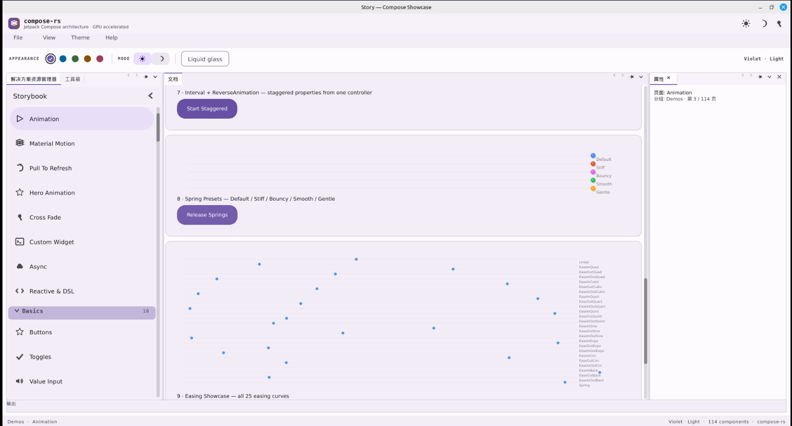
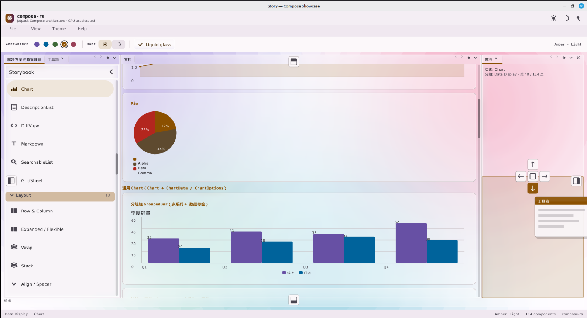
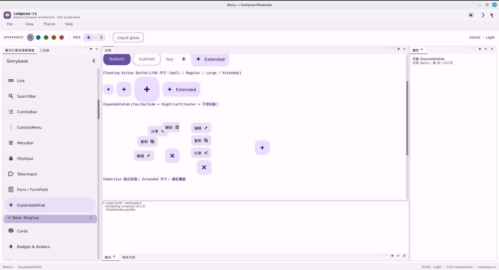

# compose-rs

[English](README_EN.md) · 简体中文

<div style="text-align:center">


[](https://crates.io/crates/rustmp) [](https://crates.io/crates/rustmp-material)  

</div>

> 状态说明：核心与控件库已发布到 crates.io（`rustmp` / `rustmp-material` v0.1.0，库名仍为 `compose` / `compose_material`）。Desktop 在 Linux 实机验证；Android 编译 + APK 安装验证；Web/WASM 编译通过。Windows / macOS / iOS / OHOS 已有平台代码，但尚未在本环境实机验证。仓库目前没有 GitHub Release、npm 包或 CI workflow；`stars` 为 GitHub 实时数据。

跨平台 Rust GUI 库，**架构严格对齐 Jetpack Compose**（SlotTable gap-buffer / Applier / Snapshot / CompositionLocal / Recomposer / Modifier.Node / GraphicsLayer / Semantics / SubcomposeLayout / 手势 / Effects 均已落地）。渲染管线：**winit 0.30 + valo + wgpu 30**（valo = 类 Flutter Impeller 的 GPU 2D 引擎）。

```rust
// 就是 Jetpack Compose 的写法（组合函数不接 `&mut Composer` 首参，内容闭包即 trailing lambda）
let count = remember(|| mutableStateOf(0i32));
Column(Modifier::new().fill_max_size(), Arrangement::Center, CrossAxisAlignment::Center, || {
    Text(format!("Count: {}", count.get()), TextStyle::new().size(32.0), Modifier::new().padding(16.0));
    Button(Modifier::new(), move || count.set(count.get() + 1), || {
        Text("Increment", TextStyle::new(), Modifier::new());
    });
});
```

## 界面预览

以下截图均来自 `cargo run --example story -p examples` 的真实运行画面（点击图片查看大图）：

<table style="margin:0 auto">
  <tr>
    <td style="text-align:center"><b>Animation</b><br><a href="screen/animation.png"></a></td>
  </tr>
  <tr>
    <td style="text-align:center"><b>Chart</b><br><a href="screen/chart.png"></a></td>
  </tr>
  <tr>
    <td style="text-align:center"><b>ExpandableFab</b><br><a href="screen/fab.png"></a></td>
  </tr>
</table>

画廊外壳包含菜单栏、分组侧栏、页面容器与状态栏；Light/Dark 主题和种子色板（Violet / Amber 等）可在 Theme 菜单运行时切换，示例中的「Liquid glass」开关演示实时毛玻璃效果。

## Workspace

| Crate | 职责 |
|---|---|
| `crates/compose` | 核心：runtime / foundation / layout / material / animation，并含渲染层 `compose::render`（valo DisplayList + wgpu GpuRenderer + 帧内核 `Kernel` + 字体 + 各平台 `surface` 入口）与跨平台宿主粘合 `compose::platform`（按 target 条件编译 `platform/{desktop,web,android,ios,ohos,services}`）；原 `compose-render`、`compose-platform` 已并入此 crate 对应命名空间 |
| `crates/compose-material` | composable 控件集（Text/Button/Card/Checkbox/Switch/Slider/TextField/Scroll…）；入口先调 `install_router()` 向核心注册输入路由 |
| `examples/` | 独立示例 crate，`story` 为 Storybook 式 114 页组件画廊（含「Compose 对齐」「多媒体」「Platform」演示分组） |
| `cpp/` | C++20 协程版 Compose 核心（头文件 `cpp/compose/include/compose/`，实现 `cpp/compose/src/`）：SlotTable / State / Snapshot / Applier / Recomposer / Modifier / Constraints-MeasurePolicy-Placeable 两阶段布局 / Widget / LaunchedEffect（`Task` + `EffectScope` 结构化取消）；平台层（X11/Win32/Cocoa/Android/iOS/OHOS/Web）+ Skia 适配层均编入单一 `compose` 静态库，界面示例 `compose_demo` 与对齐 Rust `examples/story` 的 Storybook 画廊 `compose_story_runner`（113 页 / 9 分组，`PageInfo`/`PAGES`/`GROUPS` 唯一真源 + 无头逐页探针 `story_tests`）；控件层含 9 种基础控件与 18 种 `DrawOp` 组合控件（Chip/Radio/RatingBar/图表/进度等），详见 `cpp/README.md` |

## 架构（Compose 概念 → 本库实现）

| Jetpack Compose | 本库 | 说明 |
|---|---|---|
| `@Composable fun` | 普通 `fn(..)`（无 `&mut Composer` 首参）+ trailing 闭包 | 内容闭包 = trailing lambda；作用域/节点隐式取自 thread_local 运行时 |
| `SlotTable` gap-buffer | `compose::slot_table::SlotTable` | 线性槽数组 + 可搬移 gap + group 头 + Anchor；删除圈回 gap、插入复用不扩容；`ScopeData.slots` 已接入 |
| `Applier` / `AbstractApplier` | `compose::applier::NodeApplier` / `ArenaApplier` | 节点插入/删除/移动/清空统一经可替换 applier；宿主可 `with_applier` 注入 |
| `MutableState` / `Snapshot` | `mutableStateOf` / `compose::snapshot::{snapshot, withMutableSnapshot, apply_snapshot}` | 读注册依赖、写失效读者；快照隔离读 + 批量写 + apply 提交 + read/write observer |
| 定向重组 | `RecomposeScope` 精确失效 | 状态变化只重跑**读到它**的作用域 |
| `remember` / `keyed_remember` / `rememberUpdatedState` | 同名 | 位置即身份；`rememberUpdatedState` 原地更新不重启 effect |
| `derivedStateOf` / `snapshotFlow` | 同名 | 观察者重算 + 下游失效；`snapshotFlow` 仅在值变化时发射 |
| `CompositionLocal` | `CompositionLocal<T>::provides / current` | 沿作用域祖先链查找（Compose 语义：本身不注册读取依赖） |
| `Modifier` 值链 + `Modifier.then/thenIf` | `Modifier::new().padding(..).then(..)` | 不可变值，clone 廉价；顺序敏感（measure 后写收紧） |
| `Modifier.Node` / `ModifierNodeElement` | `compose::modifier_node::{ModifierNodeImpl, delta_modifier}` | 带身份/生命周期的节点元素，`measure`/`draw` 阶段按链序参与 |
| `graphicsLayer` / `alpha` / `rotate` / `scale` | `Modifier::graphics_layer/alpha/rotate/scale` | `SaveLayer`/`Transform`/`Restore` 命令，子树整体图层合成 |
| `MeasurePolicy` / `Constraints` / `Placeable` | 同名 | 单趟测量，weight 孩子最后测 |
| `SubcomposeLayout` | `SubcomposeLayout` / `MeasureCtx::subcompose` | measure 期按 slot 请求子组合，两趟布局反馈子尺寸 |
| `LazyColumn` / `LazyRow` | 同名 | 真正虚拟列表：只组合可见区间 + 前后占位，keyed scope 视口外回收 |
| `Column` / `Row` / `Box` / `Layout` | 同名 | `Arrangement` / `Alignment` / weight / stretch |
| `Button` / `Surface` / `Card` / `Checkbox` / `Switch` / `Slider` / `TextField` | 同名 | Material 3 精简色板（light/dark） |
| `pointerInput` / `detectTapGestures` / `detectDragGestures` | `compose::gesture::{PointerInput, detect_*}` | 统一 `PointerEvent` + tap/drag 检测器（slop / 长按 / 双击） |
| `Semantics` / `SemanticsNode` / `Modifier.semantics` | `compose::semantics::{build_tree, SemanticsTree}` | 语义树（label/role/state/actions/merge/clear）+ 命中/焦点/JSON 导出 |
| `LaunchedEffect` / `DisposableEffect` / `SideEffect` / `producedState` | 同名 | 协程 arena 化；`SideEffect` 重组后执行；协程随作用域销毁取消 |
| `animateFloatAsState` / `AnimatedVisibility` / `AnimatedContent` | 同名 + `AnimatedVisibilityEx` | 帧驱动 + Enter/Exit 生命周期 + key 切换入场转场 |
| `Canvas` / `DrawScope` | `Canvas(m, |b, x, y, w, h| ..)` | 产出平台无关 `DrawCmd` |
| Media3 / `VideoPlayer` | `compose_material::widgets::video::{Video, VideoControls, VideoPlayer}` | 解码线程 + 单槽帧邮箱 + 主线程纹理上传；后端表 / 状态机 / 控制器对齐 `rui_packages::video` |

**工程约束（硬规则）**：核心库 `compose` / `compose-material` **零 `Rc` / `Arc` / `unsafe`**。节点 / 状态 / 作用域 / 任务全部 arena 化（`u32` 句柄）；回调用 take-put 模式防重入借用；UI 单线程（禁 Mutex、禁 `Rc::as_ptr` 强转）。例外：`MainWake` 跨线程 waker 用 `Arc`；`widgets/video.rs` 的解码线程用 `Arc/Mutex` 传递命令与帧（`Rc` 仅用于主线程共享控制器句柄），FFmpeg FFI 的 `unsafe` 收敛在 `csrc/ffmpeg_shim.c` 对应 Rust 声明中；`examples/story` 演示页可用 `Rc<Cell>` 做非响应式探针。

**交互 / 布局约定**：

- 按下即起手势（拖动、取色）挂 `Node.on_press`，但**必须成对配一个 `on_click`**（可为空）——`dispatch_press_down` 靠 `nearest_click_idx`（沿祖先链只认 `on_click`）判定命中链，缺 `on_click` 则命中失败、`on_press` 静默不执行（Slider / Splitter / ColorPicker 皆成对设置）。
- 新的 `pointerInput` 体系独立于此：`PointerInput(modifier, content, handler)` 注册的处理器由 `dispatch_pointer_event` 沿祖先链派发，**不需要** `on_click`；tap/drag 检测器消费统一 `PointerEvent`。
- 滚动容器在 `measure`/`place` 阶段自动为滚动条预留 `SCROLLBAR_GUTTER`（12px）交叉轴空间，内容不被滚动条覆盖；移动端（android/ios）不预留。
- Dock 拖拽入口只在 tab / tab 条同一行；面板内容区刻意不挂 `on_press`，不触发 drag & drop 提示。

## Compose 架构对齐模块（核心库新增）

| 模块 | 职责 | 主要 API |
|---|---|---|
| `compose::slot_table` | SlotTable gap-buffer（线性槽 + gap + group + Anchor） | `SlotTable::{insert_data, set_data, get_data, remove_data, start_group, end_group, truncate_data, anchor, resolve}` |
| `compose::applier` | 节点树变更抽象 | `NodeApplier`、`ArenaApplier`、`with_applier`、`move_node`、`children_of` |
| `compose::snapshot` | 事务性状态与观察 | `snapshot`、`withMutableSnapshot`、`apply_snapshot`（runtime）、`register_read/write_observer` |
| `compose::modifier_node` | Modifier.Node 生命周期 | `ModifierNodeImpl`、`update`、`detach`、`delta_modifier` |
| `compose::gesture` | pointerInput 手势 | `PointerEvent`、`PointerInput`、`detect_tap_gestures`、`detect_drag_gestures`、`dispatch_pointer_move` |
| `compose::semantics` | 语义树 / 无障碍 | `build_tree`、`SemanticsTree::{find_by_test_tag, hit_test, focus_next, perform, to_json}`、`Modifier::{semantics, content_description, test_tag, role, merge_descendants, clear_and_set_semantics, hide_from_accessibility}` |
| `compose::subcompose` | 两趟子组合请求队列 | `subcompose`、`pending`、`drain_requests`（配合 `MeasureCtx::subcompose`） |
| `compose-material::widgets::transition` | 可见性 / 内容转场 | `AnimatedVisibilityEx`、`AnimatedContent`、`VisibilityTransition`、`ContentTransform` |
| `compose-material::widgets::video` | 视频播放（参考 `rui_packages::video`） | `VideoSource`、`VideoDecoderBackend`、`VideoBackendCatalog`、`VideoPlayback`、`VideoPlayerController`、`Video`、`VideoControls`、`VideoPlayer`、`MockVideoBackend`；`build.rs` 探测 vcpkg/pkg-config FFmpeg 后启用 `cfg(compose_ffmpeg)` 真解码 |

> 对齐边界（诚实记录）：无 `@Composable` 编译器插件（Rust 手写闭包）；`AnimatedContent` 旧内容不并行 exit（引擎不能在 measure 期组合）；GraphicsLayer 的 GPU 级变换受 valo 后端能力限制（alpha 生效，transform 命令已生成但渲染层暂降级）；平台无障碍桥接尚未接线（`to_json()` 是桥接数据契约）。

## 控件集（`crates/compose-material/src/widgets/`）

按八大分类组织，每个分类一个模块：

| 模块 | 分类 | 代表控件 |
|---|---|---|
| `widgets/basic.rs` | basic | Text / Filled·Outlined·TextButton / IconButton / FAB / ExtendedFAB / ExpandableFAB / Chip / Avatar / Badge / GroupBox / SearchBar / Link / Kbd / InkWell |
| `widgets/input.rs` | input | Checkbox / TriStateCheckbox / RadioGroup / Switch / Slider / SpinBox / TextField / PasswordField / FormField / Dropdown / ComboBox / PopupMenuButton / ContextMenu / RatingBar / ColorPicker（HSV 取色器：SV 方块 + 色相条 + 预览条）/ DatePicker / TimePicker / OtpInput / TokenInput |
| `widgets/layout.rs` | layout | Scaffold / TopAppBar / BottomAppBar / FlowRow / Grid / AspectRatio / SizedBox / SplitRow / SplitColumn / Expandable |
| `widgets/data.rs` | data | ListItem / DataTable / DescriptionList / TreeView / BarChart / LineChart / PieChart / Sparkline / Linear·CircularProgress / Stepper / Bubble / DiffView / Markdown |
| `widgets/feedback.rs` | feedback | Dialog / AlertDialog / BottomSheet / ModalDrawer / Tooltip / Popover / HoverCard / Snackbar(+Host) / Banner / InlineAlert / Skeleton / Spinner / EmptyState / Notification(Stack) / CommandPalette |
| `widgets/navigation.rs` | navigation | NavigationBar / NavigationRail / NavigationDrawer / Sidebar / TabRow / Breadcrumb / Pagination / Carousel / Toolbar / TitleBar / StatusBar |
| `widgets/docking.rs` | docking | DockLayout / DockState / DockNode / DockablePanel：可拖拽停靠面板（布局树 + 5 区罗盘 + 标签页重排/重停靠 + 分割条 + 最大化 + 自动隐藏边条 + 浮动窗口 + 布局序列化）；VS 式交互细节：分割条/浮动窗八向缩放的 OS  resize 光标、拖拽中 Move/Grabbing 光标、中键关闭标签、Esc 取消拖拽并恢复原状、浮动窗拖动/缩放期间半透明 ghosting |
| `widgets/dock_layout.rs` | docking | **DockLayout（对齐 compose-docking `DockLayout.kt`）**：窗口列表模型 `DockLayout`/`DockWindow`/`WindowKind`/`WindowBounds`/`MaximizedState` + KT 不变式 + `dl1` 持久化 |
| `widgets/advanced.rs` | advanced | VerticalScroll / HorizontalScroll / Calendar / CodeBlock / RichText / SettingsSection·Item / MediaSurface |
| `widgets/rich_text_editor.rs` | advanced | **RichTextEditor（Quill 风格富文本）**：块/行内格式工具栏 + 选区 + 撤销重做 + 查找高亮 + HTML/Markdown 导入导出 |
| `widgets/animation.rs` | animation | AnimatedVisibility / Crossfade / FadeThrough / SharedAxis / SlideIn / Pulse |
| `widgets/transition.rs` | animation | AnimatedVisibilityEx（Enter/Exit 生命周期）/ AnimatedContent（key 切换转场）/ VisibilityTransition / ContentTransform |
| `widgets/video.rs` | 多媒体 | Video / VideoControls / VideoPlayer / VideoPlayerController / VideoPlayback / VideoDecoderBackend / MockVideoBackend / FFmpeg 后端 / 后端目录与能力探测 |
| `widgets/lazy_list.rs` | data | LazyColumn / LazyRow（真虚拟列表，按需组合 + 视口外回收 + 选中高亮） |
| `widgets/overlay.rs` | root_window+overlay | 全局浮层宿主（Dialog/菜单/Tooltip 统一叠最上层） |
| `widgets/glass.rs` | — | 液态玻璃开关与壁纸 |

**浮层宿主**：应用根包一层 `OverlayHost(Modifier::new().fill_max_size(), || { .. })`，
树内任意深度的控件都能用 `Overlay(key, open, || { .. })` 把内容叠到最上层——
不会撑大父容器、不被父级裁剪、不受滚动影响。key 由 `RememberOverlayKey()` 稳定持有。

## Quill 风格富文本编辑器（`RichTextEditor`）

`RichTextEditor(Modifier::new().fill_max_width().height(360.0))` 返回一个
`RichTextEditorHandle`，可直接编辑文档块并订阅变更。

```rust
let h = RichTextEditor(Modifier::new().fill_max_width().height(360.0));
h.set_html("<h2>标题</h2><p>正文 <b>加粗</b></p>");
h.toggle_bold();                 // 块/行内格式
h.set_link("https://example.com");
h.undo(); h.redo();              // 撤销 / 重做
h.set_find("关键字"); h.find_next();  // 查找（命中高亮，F3 循环）
let html = h.to_html();          // 导出 HTML
let md   = h.to_markdown();      // 导出 Markdown
h.to_plain_text(); h.char_count();
```

能力：
- **块格式** ¶ / H1 / H2 / H3 / ❝引用 / UL / OL / ☑任务列表 / 代码块
- **行内格式** B / I / U / S / `</>` 行内代码 / 文字颜色 / 超链接（pending format 继承）
- **选区** 鼠标拖选（`on_press` 建锚点 + `begin_drag_2d` 扩选）、Shift+方向键扩选、Ctrl+A 全选、Ctrl+C/X/V 剪贴板
- **撤销重做** 每次编辑压入历史快照（上限 200 步），Ctrl+Z / Ctrl+Y / Ctrl+Shift+Z
- **查找** 关键字命中高亮（当前命中加深），F3 跳下一个
- **导入导出** `set_html` / `to_html` / `to_markdown`（HTML 解析支持
  `h1~h3/p/ul/ol/li/blockquote/pre` 与 `b/i/u/s/code/a/span[color]` 行内标签）

> 控件须**每次组合都调用**（状态由内部 `remember` 持有）；内容注入用一次性守卫，
> 不要放在 `remember` 初始化闭包里，否则重组后编辑器节点会丢失。

## FAB（悬浮动作按钮 / ExpandableFab）

参考 flutter_expandable_fab 实现的完整 FAB 家族：

```rust
// 四种尺寸（FabSize::Regular / Small / Large + ExtendedFab）
FabEx(IconName::Add, FabSize::Small, Modifier::new(), || {});
Fab(IconName::Add, Modifier::new(), || {});            // = FabEx(Regular)
FabEx(IconName::Add, FabSize::Large, Modifier::new(), || {});
ExtendedFab(IconName::Add, "Extended", Modifier::new(), || {});

// 可展开 FAB：Up（向上）/ Side（向左）/ Fan（扇形）
let open = remember(|| mutableStateOf(false));
ExpandableFab(
    IconName::Add,
    &[(IconName::Edit, "编辑".into()), (IconName::Share, "分享".into())],
    FabExpandType::Up,
    open,
    Modifier::new(),
);
```

- **展开方向** `FabExpandType::Up / Side / Fan`：固定尺寸裁切盒 + 条目从 FAB 方向滑入
  （FAB 本身不动，对齐 M3 交互）。Fan 为**真实径向扇形**：条目按极坐标
  `angle = 180° + i·fan_angle/(n-1)`（180°=左 → 270°=上）、`distance·progress` 从 FAB 中心
  向左上 90° 扇区辐射，收起时整体向下推出裁切盒外裁掉；
- **开合反馈** 展开时主图标自动切换为 `Close`；
- **动作项** 胶囊（标签 + 图标，`secondary_container`），点击后自动收起；
- **状态提升** 展开/收起由外部 `MutableState<bool>` 驱动，须放在**函数作用域**的
  `remember` 里——放在闭包（如 `Row { .. }`）内部会因槽位错位读错状态。

## Docking：窗口列表模型（对齐 `DockLayout.kt`）

停靠布局的**持久化模型**对齐 compose-docking 的
`model/DockLayout.kt`（布局 = 窗口列表，瞬时 UI 状态留在 `DockState`）：

```rust
use compose_material::{DockLayout, DockWindow, WindowKind, WindowBounds, MaximizedState};

let layout = DockLayout {
    windows: vec![
        DockWindow {                       // windows[0] 必须是主窗口
            id: WINDOW_MAIN,
            kind: WindowKind::Main,
            root: Some(DockNode::tabs(&[1, 2])),
            maximized: Some(MaximizedState {   // 还原最大化 = 纯值替换
                dockable_id: 1,
                saved_root: Some(DockNode::tabs(&[3, 4])),
            }),
            bounds: None,
        },
        DockWindow {                       // 其余只能是浮动窗口
            id: 1,
            kind: WindowKind::Floating,
            root: Some(DockNode::tabs(&[5])),
            maximized: None,
            bounds: Some(WindowBounds { x: 10.0, y: 20.0, width: 300.0, height: 200.0 }),
        },
    ],
};
assert!(layout.is_valid());               // KT 的 init 不变式
```

- **KT 不变式**（`is_valid`）：窗口列表非空、`windows[0]` 是主窗口、其余是浮动窗口、
  窗口 id 不重复——KT 用 `require` 抛错，Rust 侧改为显式校验，避免 panic；
- **访问器** 与 KT 同名同义：`main_window` / `floating_windows` / `window` /
  `require_window` / `replace_window` / `empty`；
- **与运行时衔接**：`DockState::layout()` 给出窗口视图，`DockState::set_layout()`
  整份写回（KT 语义：计算整份下一份布局再赋值一次）；
- **持久化**：`serialize_dock_layout` / `parse_dock_layout_text`（`dl1` 格式），
  窗口 id + 种类 + 边界 + 最大化状态 + 根树全部可往返；
- 自动隐藏边条是 Rust 扩展、KT 模型无对应概念，故不进入窗口列表，
  由既有 `save_full_state`/`restore_full_state`（`mdl1`）无损承载。

## 液态玻璃（一个函数切换）

```rust
use compose::material::ToggleLiquidGlass;

let on = ToggleLiquidGlass();   // 开 ⇄ 关，返回切换后状态
```

- `ToggleLiquidGlass()` — **一个函数切换**
- `SetLiquidGlass(bool)` / `liquid_glass_enabled()` / `liquid_glass_state()`
- `glass_spec()` — 组合内解析当前材质规格（读状态即注册依赖 → 切换后定向重组）
- `LiquidGlassWallpaper(colors)` — 玻璃态彩色桌面（模糊需要有内容才可见）；另有 `GlassRootBackground()` / `GlassToggleButton(..)` 供控件接线

渲染层（`compose::render`）用 valo 的 `save_layer_backdrop` + 高斯背景模糊实现真正的
frosted glass（`DrawCmd::GlassPanel` = 背景模糊 + 半透明底色 + 边缘高光 + 描边）。
story 菜单中的液态玻璃开关即调用上述函数。

## 运行

```bash
cargo run --example story -p examples             # 桌面 Storybook 画廊（114 页 / 10 分组：菜单栏 + sidebar + 页面容器）
STORY_PAGE=<下标|页名> cargo run --example story   # 直接打开指定页（性能定位 / 无头复现）
cargo test  -p compose                            # 无头语义测试

# C++ 侧：CMakePresets + vcpkg（详见 cpp/README.md）
cd cpp && cmake --preset x64-linux-release && cmake --build --preset x64-linux-release -j4
ctest --preset x64-linux-release
./build-x64-linux-release/compose_story_runner
```

### 跨平台构建

渲染后端与帧内核在 `compose::render`，`compose::platform` 按 `--target` 条件编译各平台后端（同属 `compose` crate）：

```bash
# 一键交叉编译 story 到 WASM + Android（release）
./examples/scripts/build_cross.sh              # 两者都构建
./examples/scripts/build_cross.sh wasm         # 只构建 Web/WASM
./examples/scripts/build_cross.sh android      # 只构建 Android

# Web（wasm32 + wgpu WebGPU/WebGL，winit web 的 spawn_app / rAF 事件泵）
./examples/scripts/build_web.sh                # → story.wasm +（可选）web_dist/ 胶水
./examples/scripts/build_web.sh serve          # 本地静态服务器预览 web_dist
#   等价于：cargo build --release --target wasm32-unknown-unknown -p examples --example story

# Android（android-activity 直驱，不走 winit android 后端）
./examples/scripts/build_android.sh            # → bin: examples/story + so: libstory_android.so
./examples/scripts/build_apk.sh                # 打包为可安装 APK（NativeActivity）
#   NDK 从 ANDROID_NDK 或 $ANDROID_HOME/ndk/* 自动探测，API_LEVEL 默认 26
#   分层（对齐 cui）：引擎层 compose::platform::android 持有 android_main + 事件循环；
#   examples/story/android_lib.rs 只实现 compose_create_app_root 应用根注入；
#   最终 .so 由 examples 的 story_android cdylib 链接两者产出。

# iOS / OHOS（宿主驱动 C ABI；iOS 经 Swift/UIKit，OHOS 经 ArkTS/NAPI）
#   导出符号见 platform/ios.rs / platform/ohos.rs 顶部的符号表，
#   宿主工程用 native/ 桥接模板（ComposeHost.swift / ComposeBridge.ets）
```

**平台服务层（`compose::platform::services`，对齐 Flutter `services` 绑定）**

把各后端的平台能力收敛为**统一 Rust API**，业务侧无需关心目标平台：

| 能力 | 模块 | 桌面 | Web / 移动端 |
|---|---|---|---|
| 平台通道（Rust ↔ 宿主） | `services::channel` | 进程内注册表 | 宿主 C ABI 桥接 |
| 剪贴板 | `services::clipboard` | `arboard` 真实实现 | 经 channel（`clipboardSet`/`clipboardGet`） |
| 权限 | `services::permission` | 视为已授权 | 经 channel（`requestPermission`） |
| 文件对话框 | `services::file_dialog` | `rfd` 真实实现 | 返回 `None`/`空`（由宿主 `channel` 提供） |
| 网络请求 | `services::network` | `TcpStream` HTTP/1.1（`http://` GET/POST，零新增依赖） | 经 `channel`（`httpGet`/`httpPost`）交给宿主 fetch/OkHttp，支持 HTTPS |
| 应用生命周期 | `services::lifecycle` | Android 事件循环已接入（InitWindow→Resumed / TerminateWindow→Paused） |
| 相机 / 蓝牙 | `platform/camera.rs` / `platform/bluetooth.rs` | 占位实现（`available()=false`），按平台经 cfg 接入 |

调用示例：

```rust
use compose::platform::services::{clipboard, permission, lifecycle, network};
clipboard::set_text("hello").ok();
let _ = permission::request(permission::Permission::Camera);
lifecycle::add_observer(Box::new(|s| eprintln!("lifecycle {:?}", s)));
// 网络 I/O 阻塞，宜在后台线程调用，结果经 post_to_main 回投 GUI 线程写 MutableState。
if let Ok(resp) = network::get("http://example.com/ping") {
    eprintln!("HTTP {} / {} bytes", resp.status, resp.body.len());
}
```

**编译脚本（`examples/scripts/`）**

| 脚本 | 目标 |
|---|---|
| `build_cross.sh` | **一键构建** wasm + android（可传 `wasm` / `android` 单选） |
| `build_web.sh` | `wasm32-unknown-unknown` → `story.wasm`（cargo build + 可选 wasm-bindgen 胶水到 `web_dist/`） |
| `build_android.sh` | `aarch64-linux-android` → `libstory_android.so`（引擎 `android_main` + 应用根注入）+ `story` bin |
| `build_apk.sh` | 打包 `story` 为可装 APK（NativeActivity + aapt2/zipalign/apksigner） |
| `build_ios.sh` | `aarch64-apple-ios` 静态库 `libcompose.a` |
| `build_ohos.sh` | `aarch64-unknown-linux-ohos`（Tier 3，`-Z build-std`） |

> 注：iOS 需要 macOS + Xcode 工具链，OHOS 需要 DevEco + OHOS SDK，`aarch64-unknown-linux-ohos` target 需额外 `rustup target add` 且为 Tier 3。本环境已验证 `desktop`（含真实 arboard/rfd 后端）/ `aarch64-linux-android` / `wasm32-unknown-unknown`（`story` 示例）三端编译通过。Web 端 wasm-bindgen 版本须与 `Cargo.lock` 中的 `wasm-bindgen` crate 一致。

story 为 Storybook 式画廊，114 页分 10 大分组（Demos / Basics / Data Display / Layout / Navigation / Feedback / Advanced / Compose 对齐 / 多媒体 / Platform），每页用 `compose_material` 真实控件渲染；外壳为「分组侧栏 + 标题栏/菜单栏 + 状态栏 + 页面容器按需替换」。主题（Light/Dark）与种子色板（`THEME_PRESETS` + `ColorScheme::from_seed`）均在 Theme 菜单运行时切换（启动默认 light、palette 0）。

**「Compose 对齐」演示分组（8 页）**：`SlotTable`（gap-buffer 增删探针）、`Applier`（自定义 applier 拦截计数）、`Snapshot`（隔离读 + 延迟写）、`Effects`（SideEffect / producedState / snapshotFlow / rememberUpdatedState）、`Modifier.Node & GraphicsLayer`（自定义测量节点 + 图层变换）、`Subcompose & Semantics`（按需子组合 + 语义树 JSON）、`pointerInput 手势`（tap/drag 实时计数）、`AnimatedTransition`（Enter/Exit 与内容入场）。每页都带可交互控件 + 内部状态探针，便于对照 Jetpack Compose。

**「多媒体」演示分组（1 页）**：`Video` 默认播放内置 `MockVideoBackend` 帧源（无需素材即可看到画面），可用原生对话框打开本地 mp4/mkv/gif 等。解码在独立线程按 PTS 与墙钟对齐产出 RGBA，经单槽邮箱交回主线程逐帧分配新 `image_id` 上传 GPU；`VideoControls` 提供播放/暂停、首尾、±5s、点击进度条 seek，状态文本显示后端、分辨率、时钟、文件打开失败原因与解码错误。`build.rs` 探测到 vcpkg/pkg-config 的 FFmpeg 时启用真解码（本机已启用），否则自动退回 Mock 后端。`examples/build.rs` 为示例二进制写入 `DT_RPATH`（依赖库目录），因此直接运行 `target/release/examples/story` 无需再设 `LD_LIBRARY_PATH`。音频探测可见但当前无输出后端，播放为静音。

**「Platform」演示分组（1 页）**：`Multiple Windows` 演示每窗口独立的组合根 / 视口 / GPU 表面，可同时打开多个窗口并各自交互。

**侧栏 Sidebar（完整功能面）**：

- **分组（Group）**：`GROUPS` 描述分组名 + 成员页索引（`Basics` / `Layout` / `Motion` / `Graphics`）。每组有标题行（箭头 + 名称 + 数量徽标）与条目块（图标 + 标签）。分组标题（folder）用 `primary` 35% 半透明色带 + 加粗文字，与中性色条目明显区分；相邻 folder 之间留 `SPACE_SM` 间隔，色带不紧贴。
- **三态宽度**（`W_EXPANDED/W_COLLAPSED/W_MINIMIZED`）：展开 200px ↔ 图标条 56px ↔ 最小化窄条 8px，`animate_float_as_state` 平滑过渡；View 菜单 → Minimize Sidebar 进入窄条态，**悬停窄条临时展开**（reveal bridge），点击窄条恢复。
- **悬停高亮**：核心库新增 `hoverable` + `dispatch_hover_at`（mouse move 沿祖先链找最近 hover 节点，进入/离开回调，take-put 防重入）；条目悬停时 `on_surface` 8% 叠加底色。
- **逐字搜索（type-ahead）**：`handle_type_ahead` — sidebar 聚焦时直接敲页名前缀，1s 内字符累积、超时重置，跳到首个匹配的可见条目；核心库 `focusable_full` 附带 `char_handler` + `dispatch_char`，平台侧字符路由顺序为「TextField 焦点 → 焦点作用域 type-ahead」。
- **左右停靠**：View 菜单 → Dock Right 切换 sidebar 停靠右侧；主区为 Box 覆盖布局（内容铺满 + sidebar 覆盖其上，按停靠态切 `TopStart/TopEnd`），组合顺序固定 → remember 槽位稳定，切换停靠不丢状态。
- **聚焦外框（focus ring）**：获得焦点时 primary 描边 overlay；`set_focus`/`clear_focus` 失效新旧焦点作用域，焦点读者得以重组重画。
- **分组折叠动画**：点击分组标题在「全高 ↔ 0 高」间收缩，条目块 `height(frac*全高).clip(0)`，箭头按 `frac*90°` 旋转（canvas 两线段近似）。
- **键盘导航**：`RuntimeData.focused_scope` 持久化焦点（跨重组不丢），`focusable` 把键盘事件交给**最近带 key_handler 的祖先**（sidebar 整体），点内部条目 / 折叠按钮不抢焦点，↑/↓/PageUp/PageDown 在可见条目间移动（折叠分组内的条目自动跳过）。
- 图标系统：`material::IconName` 枚举 + `draw_icon` 用纯 `DrawBuilder` 基元（fill_rrect / line / fill_circle）绘制矢量字形，无外部资源依赖。

**菜单栏（真下拉）**：File（Open/Save/Exit）、View（跳转各示例页）、Theme（运行时切换 Light/Dark，无需重启）、Help（About）。点击标签弹出浮层，点击空白处（scrim）关闭。运行时主题切换原理：`dark` 状态在根作用域被读取 → 切换时根作用域重跑 → `material_theme` 重提供新配色 → 全树以新主题重新执行（remember 槽位保留）；未显式着色的文本自动继承主题 `on_surface`。

## 绘图管线

```text
组合 → LayoutNode arena → measure/place → draw_tree() → Vec<DrawCmd>（平台无关，绝对坐标）
     → build_display_list()（valo DisplayListBuilder + Paragraph 段落缓存）
     → valo::Context::render() → surface.acquire()/present()
```

字体：扫描系统目录按 UI 优先级注册（拉丁/CJK/等宽各取一个，避免多份 TTC 常驻）+ `sans-serif`/`monospace` 别名；桌面扫 `/usr/share/fonts` 等，**Android 扫 `/system/fonts`**（Roboto + DroidSansFallback，真机可显示中文），iOS/OHOS 扫各自系统目录；只有 Web(wasm32) 无文件系统时用启发式度量兜底。文本度量经全局 `TextMeasurer` 注入布局阶段。

帧调度门控：交互事件立即渲染；`animations_active()` 期间连续帧；空闲 `Wait`。

## 性能模型（动画核心对齐 `androidx.compose.animation.core`）

分四层，与 Compose 同名概念一一对应：

| Compose | 本库（`compose::animation`） | 说明 |
| --- | --- | --- |
| `MonotonicFrameClock` / `withFrameNanos` | `clock_nanos()`（`advance_frame` 累积帧间隔） | **时长以墙钟为准**：同一 spec 在 30/60/120/144Hz 下历时一致 |
| `AnimationSpec`（Tween/Spring/Snap/Keyframes/Infinite） | `AnimSpec` + `Tween` / `Spring` / `Snap` / `Keyframes` / `Infinite` | `Spring` 用阻尼振子**闭式解**（欠/临界/过阻尼），`Infinite` 带 `LoopMode::{Restart, Reverse}` |
| `VectorConverter` / `AnimationVector` | `AnimatableValue`（`T ⇄ [f32;4]`）+ `AnimVector` | 一套仿真同时服务 `f32`/`Dp`/`Offset`/`Color` |
| `Animatable<T, V>` | `Animatable<T>`（`remember_animatable` / `animate_to` / `snap_to` / `velocity`） | 中断续接**保留速度**（手势甩动交给弹簧） |
| `Recomposer` 动画集合 | `RUNNING` 注册表（`tick_animations` 每帧驱动） | **静止即退集**：到位 / 不再被采样 / 作用域销毁即出集 |
| `animateFloatAsState` | `animate_float_as_state` / `animate_dp_as_state` / `animate_color_as_state` | 追新目标；首帧静止落位（不入场补间） |
| `AnimatedVisibility` 入场 | `animate_progress_on(key, spec)` | key 变化即从 0 重播，播完退集 |

补间**只在未到达目标时**留在注册表里；帧时钟只调度这些作用域做定向重组，
到位后自动退出 → 静止画面零重组、零绘制、零上传。实测：`story` 空闲 CPU 时间增量为 0
（改造前约 45% 常驻）。旧实现的两处结构性缺陷已消除：

- 每个 `animateXAsState` 各挂一条**永久** `add_frame_driver` 且从不注销——每帧成本是
  O(创建过的动画数)；现在是 O(正在跑的动画数)。
- 计时按「帧数 ÷ 假定 60fps」——高刷屏上 0.3s 动效实际只跑 0.15s，掉帧时又拖长；
  且弹簧的物理常数（单位/秒²）无从定义。

动画控件（`compose-material::widgets::animation`）据此重接：`SharedAxis` / `FadeScale`
走 `animate_progress_on`；`Crossfade` / `FadeThrough` / `OpenContainer` 的淡入是
**draw-phase**（只在版本切换那一帧重组一次，其余全在绘制缓存上推进）；
`PullToRefresh` 指示器用核心 `Spring` 解析解收回，且只调度指示器子作用域；
`Pulse` 直接挂注册表。所有控件级帧驱动都在 `disposable_effect(..).on_dispose` 里注销。

渲染侧的三个脏信号（`compose::layout`）：

| 信号 | 含义 | 消费者 |
| --- | --- | --- |
| `Node.dirty` | 需重新测量/落位 | `perform_layout`：约束未变且根不脏 ⇒ 早返回 |
| `Node.draw_invalid` + `draw_cache` | 该子树绘制输出可能变化 | `draw_node`：未脏且几何未变 ⇒ 回放缓存，不重跑绘制闭包 |
| `SCENE_CHANGED` | 本轮是否存在**真实**脏区 | `kernel::frame`：无脏区则跳过 DisplayList 重建与 GPU 上传 |

三条约定（写控件时必须遵守）：

- 时间相关绘制（光标闪烁、进度条）**不要**直接置 `node.draw_invalid = true`，用
  `compose::layout::invalidate_draw_node(id)`——它同时失效子树与祖先链，否则会被根缓存冻结。
- 帧驱动**不要捕获 `NodeId`/`ScopeId` 字面值**（`remember` 只注册一次，重组后节点是新 arena
  下标），用 `compose_material::widgets::input::keep_repainted_while(id, active)` 让 id
  每次重组刷新；自持作用域句柄的驱动同理（存进 `Rc<Cell<_>>`，每次组合 `set` 刷新）。
- 控件级 `add_frame_driver` 必须成对写 `disposable_effect(0).on_dispose(remove_frame_driver)`，
  否则驱动随控件卸载永久驻留。

回归测试：`crates/compose/tests/animation_specs.rs`（墙钟历时 / Spring 物理 / Keyframes /
Snap / 重播 / 孤儿剪枝）、`crates/compose/tests/animation_idle.rs`（停驱）、
`crates/compose/tests/dirty_region.rs`（脏区门控）、
`crates/compose-material/tests/animation_idle.rs`（控件级：入场停止重组、驱动不累加且卸载即注销）。

## 异步接入（feature 方式）

`compose` 的可选 feature：`tokio` / `async-std`（默认均关闭，零异步依赖；同时开启时 tokio 优先）。
`examples` 同名 feature 会透传：`cargo run -p examples --example story --features tokio`。

- `compose::async_rt::spawn(future)`：Future 在 GUI 主线程任务池 poll（可直接读写 `MutableState`），
  返回 arena 化 `TaskId`；waker 通过 `post_to_main` + 续帧请求唤醒宿主（无 unsafe）。
- `compose::async_rt::sleep(duration)`：tokio / async-std 定时器（后台 runtime 驱动 reactor），
  默认实现用墙钟帧时钟 + 定点唤醒，宿主休眠不会停摆。
- `compose::async_rt::spawn_blocking(f, done)`：对应运行时的阻塞池（默认退化为 `std::thread`），
  结果经 `post_to_main` 回投主线程执行 `done`。
- 结构性约束：节点/状态/作用域在线程局部 arena（`!Send`），外部执行器只负责「何时就绪」，
  Future 本身必须留在主线程 poll；story 的 Async 页有「启动协程 sleep(1.2s)」演示。

回归：`crates/compose/tests/async_rt.rs`（三种 feature 组合各跑 29 个 compose 测试套件全绿）。

## 多窗口（multiple window）

多窗口 = **共享同一线程运行时 arena + 每窗口一个组合根**（对齐 Compose「单 Recomposer + 多 ComposeScene」），
不是每个窗口一套 runtime：节点 / 作用域 / 状态 id 仍全局唯一，窗口之间可以共享状态而不串号。

| API | 说明 |
|---|---|
| `WindowConfig` | 标题 + 逻辑尺寸（`None` = 平台默认，语义同 `Dp.Unspecified`） |
| `open_window(config, app) -> WindowHandle` | 打开新窗口；`app` 拥有该窗口的内容与主题（`App::content` / `App::theme`）。可在组合闭包或事件回调里调用（实际建窗在下一次事件循环迭代，避免重入运行时） |
| `close_window(handle)` | 请求关闭；最后一个窗口关闭时应用退出 |
| `current_window() -> Option<WindowHandle>` | 组合期 / 该窗口事件派发期间的当前窗口（子窗口里「关闭自己」的按钮用它） |
| `window_count()` | 当前打开的窗口数 |

引擎侧隔离（多窗口必须成立的不变量）：

- **视口按根**（`layout::VIEWPORTS`）：`viewport_size()` 只返回当前窗口的尺寸，Dialog / Snackbar / 菜单居中不会串窗；组合 / 布局 / 输入 / 绘制期由 `CURRENT_ROOT` 提供归属上下文（`Kernel` 内是 `RootCtx` RAII 守卫）。
- **布局约束按根**（`RuntimeData::last_constraints: HashMap<root, Constraints>`）：某个窗口 resize 只失效自己的子树，别的窗口的「约束未变 ⇒ 早返回」不受影响。
- **绘制脏区按根**（`RENDER_DIRTY_ROOTS` / `SCENE_WALKED_ROOTS`）：A 窗口的失效不会把 B 窗口拖进全量重绘；无根上下文的失效走「未知序号 epoch」，各根下次遍历时自然重绘一次。
- **全局帧时钟每轮只推进一次**（宿主 `pump` 内 `advance_frame`）：N 个窗口的动画不会快 N 倍；`Kernel::frame`（单窗口 / 平台自驱）与 `Kernel::draw_frame`（宿主已推进）是两个入口。
- **续帧按根**（`animation::running_animation_roots()` + `Recomposer::pending_for_root(root)`）：只给「有动画 / 有待重组」的窗口请求下一帧，静止窗口保持 `ControlFlow::Wait`（空闲 CPU 为 0）。
- **输入态**：每窗口独立鼠标坐标；全局键盘焦点在窗口失焦时释放（`Focused(false) → clear_focus`）、指针离开窗口清悬停（`CursorLeft → pointer_leave`）；光标形状只应用到最近活动的窗口。
- **关窗回收**：`Composition::dispose()` 回收该根的作用域 / 节点 / 视口 / 布局约束（根节点无父节点，可达性 GC 会把它当独立根保活，必须显式 `release_node`），随后 drop `Arc<Window>` 由平台销毁窗口。

平台覆盖：桌面 / Web（winit 多窗口）完整支持；Android / iOS / OHOS 由各自宿主驱动单 Surface，多窗口需平台后端提供多个窗口句柄（story 的 Multiple Windows 页在这些平台显示说明占位）。

回归：`crates/compose/tests/multi_window.rs`（视口 / 布局 / 脏区按根隔离 + 关窗只回收本根）。

## 已知限制（第一阶段）

- **多窗口已支持**（见上节「多窗口」）：每窗口一个 `Kernel`，共享同一 arena。仍未支持的是「同一窗口内的多个 Composition 并存」——`DockLayout` 的「浮动窗口」仍是树内绝对定位浮层（带标题栏拖动/缩放/回靠），不是 OS 级独立窗口
- Docking 面板注册表为 thread_local 全局表（单组合前提）：注册表与几何表按组合期刷新，跨组合/多实例并存需额外隔离；标签头拖放的释放点依赖核心 `begin_drag_2d_with_end` 的抬起回调
- 重组复用按位置编码（对齐 SlotTable 语义），**同作用域内 if/else 分支结构需稳定**（Compose 同规则，需 key 的场景用 `keyed_remember`）
- `TextField` 为精简版（点击聚焦 + 字符/退格路由 + 鼠标拖选）；无 IME / 复杂选区；`RichTextEditor` 有完整跨块拖选 + 撤销重做 + 查找
- 坐标系为窗口物理像素，`Density` 贯通（dp 逻辑像素）待接
- 平台覆盖：
  - **desktop**：✅ 编译并通过 GUI 实机验证（本机 Intel UHD 730 + wgpu 正常出帧，空闲 CPU 实测 0%）。
  - **Android**：✅ `aarch64-linux-android` 编译通过 + APK 打包/安装验证（`platform/android.rs` 用 `android-activity` 的 `poll_events` 直驱，从 `native_window()` 取 `ANativeWindow` 喂 `create_surface_from_native_window`；触摸→鼠标单指映射）。Manifest 须 `android:hasCode="false"`（纯 NativeActivity 无 dex）且 .so 以 STORED 打入并 16KB 对齐，否则 `INSTALL_FAILED_INVALID_APK: code is missing`。字体从 `/system/fonts` 加载 Roboto/DroidSansFallback，真机文字正常显示。
  - **Web (wasm32)**：✅ 编译通过（`compose` 库 + `story` 示例，`cargo check/build --target wasm32-unknown-unknown -p examples --example story` 实测 Finished）；winit 在 wasm32 下使用 `web_time::Instant`，已通过 cfg 别名兼容。本环境因 overlayfs 拒绝 `utimes` 导致 cargo 解包失败，需 `LD_PRELOAD` 一个把 `utimes/utimensat` 置为 no-op 的 shim 才能跑通，普通机器无需此步）。
  - **iOS / OHOS**：代码采用宿主驱动 C ABI 模型（`platform/ios.rs` / `platform/ohos.rs` 导出 `compose_ios_*` / `compose_ohos_*` 符号），但需 macOS+Xcode / DevEco+OHOS SDK 实机接入，暂未在本环境编译。
- 权重布局 `Modifier.weight(w, fill)` 已实现，`IntrinsicMeasurements` 未实现

## 验证策略

日常开发**只验证 desktop**：`cargo test --workspace --tests` + `cargo check --example story -p examples`。
跨平台（WASM / Android）按需用 `build_cross.sh` 单独验证（最近一次全端验证通过，后续改动默认不再逐端跑）。
