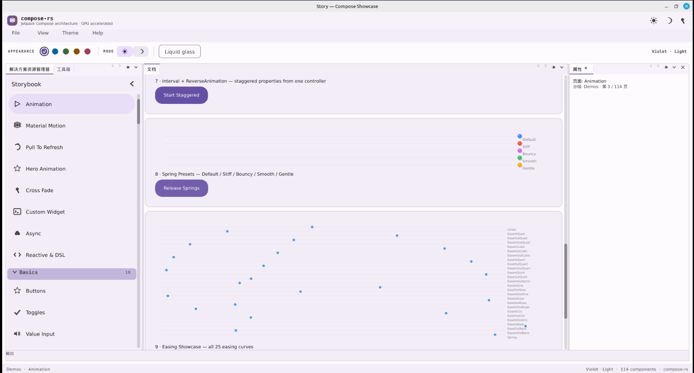
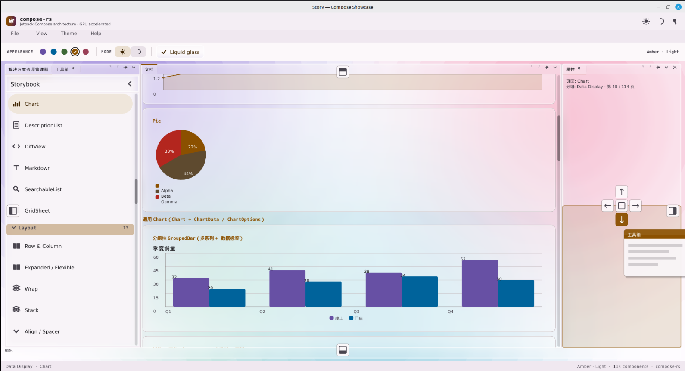
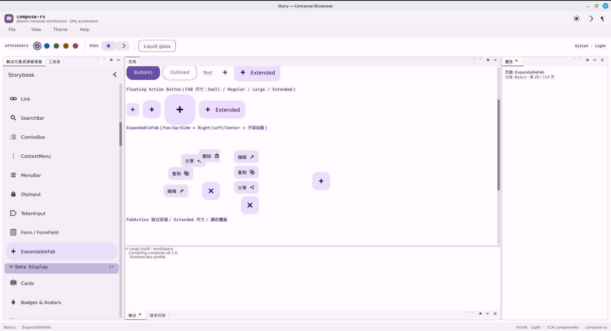

# compose-rs

[简体中文](README.md) · English

<div style="text-align:center">


[](https://crates.io/crates/rustmp) [](https://crates.io/crates/rustmp-material)  

</div>

> Status: the core and widget libraries are published on crates.io (`rustmp` / `rustmp-material` v0.1.0, with library names still `compose` / `compose_material`). Desktop is verified on Linux; Android compile + APK installation are verified; Web/WASM compiles. Windows / macOS / iOS / OHOS have platform code but are not device-verified in this environment. There is currently no GitHub Release, npm package, or CI workflow; `stars` is the live GitHub count.

Cross-platform Rust GUI library with an architecture strictly aligned with Jetpack Compose (SlotTable gap-buffer, Applier, Snapshot, CompositionLocal, Recomposer, Modifier.Node, GraphicsLayer, Semantics, SubcomposeLayout, gestures, and Effects are all implemented). Rendering pipeline: **winit 0.30 + valo + wgpu 30** (valo is a GPU 2D engine similar to Flutter's Impeller).

```rust
// Just like Jetpack Compose (composables take no leading `&mut Composer`; the content closure is a trailing lambda)
let count = remember(|| mutableStateOf(0i32));
Column(Modifier::new().fill_max_size(), Arrangement::Center, CrossAxisAlignment::Center, || {
    Text(format!("Count: {}", count.get()), TextStyle::new().size(32.0), Modifier::new().padding(16.0));
    Button(Modifier::new(), move || count.set(count.get() + 1), || {
        Text("Increment", TextStyle::new(), Modifier::new());
    });
});
```

## Screenshots

All screenshots come from a real `cargo run --example story -p examples` session (click an image to enlarge):

<table style="margin:0 auto">
  <tr>
    <td style="text-align:center"><b>Animation</b><br><a href="screen/animation.png"></a></td>
  </tr>
  <tr>
    <td style="text-align:center"><b>Chart</b><br><a href="screen/chart.png"></a></td>
  </tr>
  <tr>
    <td style="text-align:center"><b>ExpandableFab</b><br><a href="screen/fab.png"></a></td>
  </tr>
</table>

The gallery shell includes a menu bar, a grouped sidebar, a page container, and a status bar. Light/Dark themes and seed palettes (Violet / Amber, etc.) can be switched at runtime from the Theme menu, and the "Liquid glass" toggle demonstrates live frosted glass.

## Workspace

| Crate | Responsibility |
|---|---|
| `crates/compose` | Core: runtime / foundation / layout / material / animation, plus the rendering layer `compose::render` (valo DisplayList + wgpu GpuRenderer + frame `Kernel` + fonts + per-platform `surface` entry points) and cross-platform host glue `compose::platform` (conditionally compiled `platform/{desktop,web,android,ios,ohos,services}` per target); the former `compose-render` and `compose-platform` crates have been merged into this crate's corresponding namespaces |
| `crates/compose-material` | Composable widget set (Text/Button/Card/Checkbox/Switch/Slider/TextField/Scroll…); entry points first call `install_router()` to register input routing with the core |
| `examples/` | Standalone example crate; `story` is a Storybook-style gallery with 114 pages (including the "Compose Alignment", "Multimedia", and "Platform" demo groups) |
| `cpp/` | C++20 coroutine version of the Compose core (headers in `cpp/compose/include/compose/`, implementation in `cpp/compose/src/`): SlotTable / State / Snapshot / Applier / Recomposer / Modifier / Constraints–MeasurePolicy–Placeable two-phase layout / Widget / LaunchedEffect (`Task` + `EffectScope` structured cancellation); the platform layer (X11/Win32/Cocoa/Android/iOS/OHOS/Web) and Skia adapter are compiled into a single `compose` static library, with the UI demo `compose_demo` and the Storybook gallery `compose_story_runner` aligned with Rust's `examples/story` (113 pages / 9 groups, `PageInfo`/`PAGES`/`GROUPS` as the single source of truth + a headless per-page probe in `story_tests`); the widget layer includes 9 basic widgets and 18 compositional `DrawOp` widgets (Chip/Radio/RatingBar/charts/progress, etc.); see `cpp/README.md` |

## Architecture (Compose concept → implementation in this library)

| Jetpack Compose | This library | Notes |
|---|---|---|
| `@Composable fun` | plain `fn(..)` (no leading `&mut Composer`) + trailing closure | Content closure = trailing lambda; scope/node implicitly taken from the thread-local runtime |
| `SlotTable` gap-buffer | `compose::slot_table::SlotTable` | Linear slot array + movable gap + group headers + Anchors; deletions recycle into the gap and insertions reuse capacity; `ScopeData.slots` is wired in |
| `Applier` / `AbstractApplier` | `compose::applier::NodeApplier` / `ArenaApplier` | Node insert/remove/move/clear all go through a replaceable applier; hosts can inject one via `with_applier` |
| `MutableState` / `Snapshot` | `mutableStateOf` / `compose::snapshot::{snapshot, withMutableSnapshot, apply_snapshot}` | Reads register dependencies, writes invalidate readers; snapshot-isolated reads + batched writes + apply commit + read/write observers |
| Targeted recomposition | `RecomposeScope` precise invalidation | State changes only rerun the scopes that read them |
| `remember` / `keyed_remember` / `rememberUpdatedState` | same names | Position is identity; `rememberUpdatedState` updates in place without restarting effects |
| `derivedStateOf` / `snapshotFlow` | same names | Observer recomputation + downstream invalidation; `snapshotFlow` emits only on value changes |
| `CompositionLocal` | `CompositionLocal<T>::provides / current` | Lookup along the scope ancestor chain (Compose semantics: reading does not register a dependency) |
| `Modifier` value chain + `Modifier.then/thenIf` | `Modifier::new().padding(..).then(..)` | Immutable value, cheap to clone; order-sensitive (tightening after measure) |
| `Modifier.Node` / `ModifierNodeElement` | `compose::modifier_node::{ModifierNodeImpl, delta_modifier}` | Node elements with identity/lifecycle; `measure`/`draw` phases run in chain order |
| `graphicsLayer` / `alpha` / `rotate` / `scale` | `Modifier::graphics_layer/alpha/rotate/scale` | `SaveLayer`/`Transform`/`Restore` commands for whole-subtree layer compositing |
| `MeasurePolicy` / `Constraints` / `Placeable` | same names | Single-pass measurement; weighted children measured last |
| `SubcomposeLayout` | `SubcomposeLayout` / `MeasureCtx::subcompose` | Request sub-compositions by slot during measure; two-pass layout feeds child sizes back |
| `LazyColumn` / `LazyRow` | same names | True virtual lists: compose only the visible range + placeholders, recycle keyed scopes outside the viewport |
| `Column` / `Row` / `Box` / `Layout` | same names | `Arrangement` / `Alignment` / weight / stretch |
| `Button` / `Surface` / `Card` / `Checkbox` / `Switch` / `Slider` / `TextField` | same names | Condensed Material 3 palette (light/dark) |
| `pointerInput` / `detectTapGestures` / `detectDragGestures` | `compose::gesture::{PointerInput, detect_*}` | Unified `PointerEvent` + tap/drag detectors (slop / long press / double tap) |
| `Semantics` / `SemanticsNode` / `Modifier.semantics` | `compose::semantics::{build_tree, SemanticsTree}` | Semantics tree (label/role/state/actions/merge/clear) + hit test/focus/JSON export |
| `LaunchedEffect` / `DisposableEffect` / `SideEffect` / `producedState` | same names | Coroutines are arena-allocated; `SideEffect` runs after recomposition; coroutines cancel when their scope is disposed |
| `animateFloatAsState` / `AnimatedVisibility` / `AnimatedContent` | same names + `AnimatedVisibilityEx` | Frame-driven + Enter/Exit lifecycle + key-switch enter transitions |
| `Canvas` / `DrawScope` | `Canvas(m, |b, x, y, w, h| ..)` | Emits platform-independent `DrawCmd`s |
| Media3 / `VideoPlayer` | `compose_material::widgets::video::{Video, VideoControls, VideoPlayer}` | Decode thread + single-slot frame mailbox + main-thread texture upload; backend table / state machine / controller aligned with `rui_packages::video` |

**Engineering constraints (hard rules)**: the core libraries `compose` / `compose-material` contain **zero `Rc` / `Arc` / `unsafe`**. Nodes, states, scopes, and tasks are all arena-allocated (`u32` handles); callbacks use take-put to prevent re-entrant borrows; the UI is single-threaded (no Mutex, no `Rc::as_ptr` casts). Exceptions: the cross-thread waker `MainWake` uses `Arc`; the decoder thread in `widgets/video.rs` uses `Arc/Mutex` to pass commands and frames (`Rc` is only used to share the controller handle on the main thread); FFmpeg FFI `unsafe` is confined to the corresponding Rust declarations in `csrc/ffmpeg_shim.c`; `examples/story` demo pages may use `Rc<Cell>` for non-reactive probes.

**Interaction / layout conventions**:

- Gestures that start on press (drag, color picking) attach `Node.on_press`, but **must be paired with an `on_click`** (which may be empty) — `dispatch_press_down` determines the hit chain via `nearest_click_idx` (only `on_click` is recognized along the ancestor chain); without `on_click` the hit fails and `on_press` silently never runs (Slider / Splitter / ColorPicker all set both).
- The new `pointerInput` system is independent of this: handlers registered by `PointerInput(modifier, content, handler)` are dispatched along the ancestor chain by `dispatch_pointer_event` and **do not need** `on_click`; tap/drag detectors consume a unified `PointerEvent`.
- Scroll containers automatically reserve `SCROLLBAR_GUTTER` (12 px) of cross-axis space during `measure`/`place` so content is not covered by the scrollbar; mobile targets (android/ios) reserve nothing.
- Dock drag entry points exist only on the tab / tab strip row; panel content deliberately has no `on_press`, so dragging content does not trigger drag & drop hints.

## Compose architecture alignment modules (new in the core library)

| Module | Responsibility | Main API |
|---|---|---|
| `compose::slot_table` | SlotTable gap-buffer (linear slots + gap + groups + Anchors) | `SlotTable::{insert_data, set_data, get_data, remove_data, start_group, end_group, truncate_data, anchor, resolve}` |
| `compose::applier` | Node-tree mutation abstraction | `NodeApplier`, `ArenaApplier`, `with_applier`, `move_node`, `children_of` |
| `compose::snapshot` | Transactional state and observation | `snapshot`, `withMutableSnapshot`, `apply_snapshot` (runtime), `register_read/write_observer` |
| `compose::modifier_node` | Modifier.Node lifecycle | `ModifierNodeImpl`, `update`, `detach`, `delta_modifier` |
| `compose::gesture` | pointerInput gestures | `PointerEvent`, `PointerInput`, `detect_tap_gestures`, `detect_drag_gestures`, `dispatch_pointer_move` |
| `compose::semantics` | Semantics tree / accessibility | `build_tree`, `SemanticsTree::{find_by_test_tag, hit_test, focus_next, perform, to_json}`, `Modifier::{semantics, content_description, test_tag, role, merge_descendants, clear_and_set_semantics, hide_from_accessibility}` |
| `compose::subcompose` | Two-pass sub-composition request queue | `subcompose`, `pending`, `drain_requests` (used with `MeasureCtx::subcompose`) |
| `compose-material::widgets::transition` | Visibility / content transitions | `AnimatedVisibilityEx`, `AnimatedContent`, `VisibilityTransition`, `ContentTransform` |
| `compose-material::widgets::video` | Video playback (modeled after `rui_packages::video`) | `VideoSource`, `VideoDecoderBackend`, `VideoBackendCatalog`, `VideoPlayback`, `VideoPlayerController`, `Video`, `VideoControls`, `VideoPlayer`, `MockVideoBackend`; `build.rs` probes vcpkg/pkg-config for FFmpeg and enables real decoding via `cfg(compose_ffmpeg)` |

> Alignment boundaries (honest notes): no `@Composable` compiler plugin (composables are hand-written closures in Rust); `AnimatedContent` does not run the old content's exit in parallel (the engine cannot compose during measure); GraphicsLayer GPU-level transforms are limited by the valo backend (alpha works, transform commands are emitted but currently degraded in rendering); platform accessibility bridging is not wired up yet (`to_json()` is the bridge data contract).

## Widget set (`crates/compose-material/src/widgets/`)

Organized into eight categories, one module per category:

| Module | Category | Representative widgets |
|---|---|---|
| `widgets/basic.rs` | basic | Text / Filled·Outlined·TextButton / IconButton / FAB / ExtendedFAB / ExpandableFAB / Chip / Avatar / Badge / GroupBox / SearchBar / Link / Kbd / InkWell |
| `widgets/input.rs` | input | Checkbox / TriStateCheckbox / RadioGroup / Switch / Slider / SpinBox / TextField / PasswordField / FormField / Dropdown / ComboBox / PopupMenuButton / ContextMenu / RatingBar / ColorPicker (HSV picker: SV square + hue bar + preview bar) / DatePicker / TimePicker / OtpInput / TokenInput |
| `widgets/layout.rs` | layout | Scaffold / TopAppBar / BottomAppBar / FlowRow / Grid / AspectRatio / SizedBox / SplitRow / SplitColumn / Expandable |
| `widgets/data.rs` | data | ListItem / DataTable / DescriptionList / TreeView / BarChart / LineChart / PieChart / Sparkline / Linear·CircularProgress / Stepper / Bubble / DiffView / Markdown |
| `widgets/feedback.rs` | feedback | Dialog / AlertDialog / BottomSheet / ModalDrawer / Tooltip / Popover / HoverCard / Snackbar(+Host) / Banner / InlineAlert / Skeleton / Spinner / EmptyState / Notification(Stack) / CommandPalette |
| `widgets/navigation.rs` | navigation | NavigationBar / NavigationRail / NavigationDrawer / Sidebar / TabRow / Breadcrumb / Pagination / Carousel / Toolbar / TitleBar / StatusBar |
| `widgets/docking.rs` | docking | DockLayout / DockState / DockNode / DockablePanel: draggable dock panels (layout tree + 5-zone compass + tab reorder/redock + splitters + maximize + auto-hide edge strips + floating windows + layout serialization); VS-style details: OS resize cursors for splitters/floating windows in 8 directions, Move/Grabbing cursors while dragging, middle-click to close tabs, Esc to cancel drag and restore, translucent ghosting while moving/resizing floating windows |
| `widgets/dock_layout.rs` | docking | **DockLayout (aligned with compose-docking's `DockLayout.kt`)**: window-list model `DockLayout`/`DockWindow`/`WindowKind`/`WindowBounds`/`MaximizedState` + KT invariants + `dl1` persistence |
| `widgets/advanced.rs` | advanced | VerticalScroll / HorizontalScroll / Calendar / CodeBlock / RichText / SettingsSection·Item / MediaSurface |
| `widgets/rich_text_editor.rs` | advanced | **RichTextEditor (Quill-style rich text)**: block/inline formatting toolbar + selection + undo/redo + find highlighting + HTML/Markdown import/export |
| `widgets/animation.rs` | animation | AnimatedVisibility / Crossfade / FadeThrough / SharedAxis / SlideIn / Pulse |
| `widgets/transition.rs` | animation | AnimatedVisibilityEx (Enter/Exit lifecycle) / AnimatedContent (key-switch transitions) / VisibilityTransition / ContentTransform |
| `widgets/video.rs` | multimedia | Video / VideoControls / VideoPlayer / VideoPlayerController / VideoPlayback / VideoDecoderBackend / MockVideoBackend / FFmpeg backend / backend catalog and capability probing |
| `widgets/lazy_list.rs` | data | LazyColumn / LazyRow (true virtual lists, compose on demand + recycle outside viewport + selected-row highlight) |
| `widgets/overlay.rs` | root_window+overlay | Global overlay host (Dialog/menus/Tooltips uniformly layered on top) |
| `widgets/glass.rs` | — | Liquid glass toggle and wallpaper |

**Overlay host**: wrap the app root in `OverlayHost(Modifier::new().fill_max_size(), || { .. })`; any widget at any depth can then use `Overlay(key, open, || { .. })` to layer content on top — without enlarging its parent, being clipped by it, or being affected by scrolling. The key is held stably by `RememberOverlayKey()`.

## Quill-style rich text editor (`RichTextEditor`)

`RichTextEditor(Modifier::new().fill_max_width().height(360.0))` returns a `RichTextEditorHandle` for direct document-block editing and change subscription.

```rust
let h = RichTextEditor(Modifier::new().fill_max_width().height(360.0));
h.set_html("<h2>标题</h2><p>正文 <b>加粗</b></p>");
h.toggle_bold();                 // block/inline formatting
h.set_link("https://example.com");
h.undo(); h.redo();              // undo / redo
h.set_find("关键字"); h.find_next();  // find (highlight matches, cycle with F3)
let html = h.to_html();          // export HTML
let md   = h.to_markdown();      // export Markdown
h.to_plain_text(); h.char_count();
```

Capabilities:
- **Block formats** ¶ / H1 / H2 / H3 / ❝ quote / UL / OL / ☑ task list / code block
- **Inline formats** B / I / U / S / `</>` inline code / text color / hyperlinks (pending-format inheritance)
- **Selection** mouse drag selection (`on_press` sets anchor + `begin_drag_2d` extends), Shift+arrow extension, Ctrl+A select all, Ctrl+C/X/V clipboard
- **Undo/redo** every edit pushes a history snapshot (200-step cap), Ctrl+Z / Ctrl+Y / Ctrl+Shift+Z
- **Find** keyword match highlighting (current match emphasized), F3 jumps to the next
- **Import/export** `set_html` / `to_html` / `to_markdown` (HTML parsing supports `h1~h3/p/ul/ol/li/blockquote/pre` and inline `b/i/u/s/code/a/span[color]` tags)

> The widget must be called on **every composition** (state is held by internal `remember`); inject content with a one-shot guard, not inside a `remember` init closure, or the editor node will be lost after recomposition.

## FAB (floating action button / ExpandableFab)

A complete FAB family modeled after flutter_expandable_fab:

```rust
// Four sizes (FabSize::Regular / Small / Large + ExtendedFab)
FabEx(IconName::Add, FabSize::Small, Modifier::new(), || {});
Fab(IconName::Add, Modifier::new(), || {});            // = FabEx(Regular)
FabEx(IconName::Add, FabSize::Large, Modifier::new(), || {});
ExtendedFab(IconName::Add, "Extended", Modifier::new(), || {});

// Expandable FAB: Up (upward) / Side (leftward) / Fan (radial)
let open = remember(|| mutableStateOf(false));
ExpandableFab(
    IconName::Add,
    &[(IconName::Edit, "编辑".into()), (IconName::Share, "分享".into())],
    FabExpandType::Up,
    open,
    Modifier::new(),
);
```

- **Expansion directions** `FabExpandType::Up / Side / Fan`: fixed-size clip box + items sliding in from the FAB direction (the FAB itself stays put, matching M3 interaction). Fan is a **true radial fan**: items use polar coordinates `angle = 180° + i·fan_angle/(n-1)` (180° = left → 270° = up), radiating into the upper-left 90° sector at `distance·progress`; on collapse they are pushed down out of the clip box.
- **Open/close feedback** the main icon automatically switches to `Close` while expanded.
- **Action items** pills (label + icon, `secondary_container`), auto-collapse after click.
- **State hoisting** expansion is driven by an external `MutableState<bool>` kept in a `remember` at **function scope** — putting it inside a closure (e.g. `Row { .. }`) shifts slots and reads the wrong state.

## Docking: window-list model (aligned with `DockLayout.kt`)

The **persistence model** of dock layout is aligned with compose-docking's `model/DockLayout.kt` (layout = list of windows; transient UI state stays in `DockState`):

```rust
use compose_material::{DockLayout, DockWindow, WindowKind, WindowBounds, MaximizedState};

let layout = DockLayout {
    windows: vec![
        DockWindow {                       // windows[0] must be the main window
            id: WINDOW_MAIN,
            kind: WindowKind::Main,
            root: Some(DockNode::tabs(&[1, 2])),
            maximized: Some(MaximizedState {   // restoring maximization = pure value replacement
                dockable_id: 1,
                saved_root: Some(DockNode::tabs(&[3, 4])),
            }),
            bounds: None,
        },
        DockWindow {                       // all others must be floating windows
            id: 1,
            kind: WindowKind::Floating,
            root: Some(DockNode::tabs(&[5])),
            maximized: None,
            bounds: Some(WindowBounds { x: 10.0, y: 20.0, width: 300.0, height: 200.0 }),
        },
    ],
};
assert!(layout.is_valid());               // KT's init invariants
```

- **KT invariants** (`is_valid`): non-empty window list, `windows[0]` is the main window, the rest are floating, window ids are unique — KT throws via `require`; Rust uses explicit validation to avoid panics.
- **Accessors** same names/meanings as KT: `main_window` / `floating_windows` / `window` / `require_window` / `replace_window` / `empty`.
- **Runtime bridge**: `DockState::layout()` gives a window view; `DockState::set_layout()` writes the whole thing back (KT semantics: compute the entire next layout, then assign once).
- **Persistence**: `serialize_dock_layout` / `parse_dock_layout_text` (`dl1` format); window id + kind + bounds + maximization state + root tree round-trip.
- Auto-hide edge strips are a Rust extension with no KT model counterpart, so they are not part of the window list and are carried losslessly by the existing `save_full_state`/`restore_full_state` (`mdl1`).

## Liquid glass (one function to toggle)

```rust
use compose::material::ToggleLiquidGlass;

let on = ToggleLiquidGlass();   // toggle on ⇄ off, returns the new state
```

- `ToggleLiquidGlass()` — **one-function toggle**
- `SetLiquidGlass(bool)` / `liquid_glass_enabled()` / `liquid_glass_state()`
- `glass_spec()` — resolve the current material spec inside a composition (reading the state registers a dependency → targeted recomposition on toggle)
- `LiquidGlassWallpaper(colors)` — colorful glass desktop (blur is only visible with content behind it); `GlassRootBackground()` / `GlassToggleButton(..)` are also available for widget wiring

The rendering layer (`compose::render`) implements true frosted glass with valo's `save_layer_backdrop` + Gaussian background blur (`DrawCmd::GlassPanel` = background blur + translucent tint + edge highlight + stroke). The story menu's liquid glass toggle calls the functions above.

## Running

```bash
cargo run --example story -p examples             # desktop Storybook gallery (114 pages / 10 groups: menu bar + sidebar + page container)
STORY_PAGE=<index|page name> cargo run --example story   # open a specific page directly (profiling / headless reproduction)
cargo test  -p compose                            # headless semantics tests

# C++ side: CMakePresets + vcpkg (see cpp/README.md)
cd cpp && cmake --preset x64-linux-release && cmake --build --preset x64-linux-release -j4
ctest --preset x64-linux-release
./build-x64-linux-release/compose_story_runner
```

### Cross-platform builds

The rendering backend and frame kernel live in `compose::render`; `compose::platform` conditionally compiles each platform backend per `--target` (both in the `compose` crate):

```bash
# One-shot cross-compile of story to WASM + Android (release)
./examples/scripts/build_cross.sh              # build both
./examples/scripts/build_cross.sh wasm         # Web/WASM only
./examples/scripts/build_cross.sh android      # Android only

# Web (wasm32 + wgpu WebGPU/WebGL, winit web spawn_app / rAF event pump)
./examples/scripts/build_web.sh                # → story.wasm + (optional) web_dist/ glue
./examples/scripts/build_web.sh serve          # local static server for web_dist
#   equivalent to: cargo build --release --target wasm32-unknown-unknown -p examples --example story

# Android (android-activity driven directly, not via the winit android backend)
./examples/scripts/build_android.sh            # → bin: examples/story + so: libstory_android.so
./examples/scripts/build_apk.sh                # package as an installable APK (NativeActivity)
#   NDK auto-detected from ANDROID_NDK or $ANDROID_HOME/ndk/*, API_LEVEL defaults to 26
#   layering (aligned with cui): engine-layer compose::platform::android owns android_main + the event loop;
#   examples/story/android_lib.rs only implements the compose_create_app_root app-root injection;
#   the final .so is linked by examples' story_android cdylib from both parts.

# iOS / OHOS (host-driven C ABI; iOS via Swift/UIKit, OHOS via ArkTS/NAPI)
#   exported symbols are listed at the top of platform/ios.rs / platform/ohos.rs;
#   host projects use the native/ bridge templates (ComposeHost.swift / ComposeBridge.ets)
```

**Platform services layer (`compose::platform::services`, aligned with Flutter `services` bindings)**

Platform capabilities across backends are unified into a **single Rust API**, so application code does not need to care about the target platform:

| Capability | Module | Desktop | Web / mobile |
|---|---|---|---|
| Platform channel (Rust ↔ host) | `services::channel` | in-process registry | host C ABI bridge |
| Clipboard | `services::clipboard` | real `arboard` implementation | via channel (`clipboardSet`/`clipboardGet`) |
| Permissions | `services::permission` | treated as granted | via channel (`requestPermission`) |
| File dialogs | `services::file_dialog` | real `rfd` implementation | returns `None`/empty (provided by the host `channel`) |
| Network requests | `services::network` | `TcpStream` HTTP/1.1 (`http://` GET/POST, zero new dependencies) | via `channel` (`httpGet`/`httpPost`) to host fetch/OkHttp, supports HTTPS |
| App lifecycle | `services::lifecycle` | Android event loop wired up (InitWindow→Resumed / TerminateWindow→Paused) |
| Camera / Bluetooth | `platform/camera.rs` / `platform/bluetooth.rs` | placeholder implementations (`available()=false`), wired per platform via cfg |

Example usage:

```rust
use compose::platform::services::{clipboard, permission, lifecycle, network};
clipboard::set_text("hello").ok();
let _ = permission::request(permission::Permission::Camera);
lifecycle::add_observer(Box::new(|s| eprintln!("lifecycle {:?}", s)));
// Network I/O blocks; call it on a background thread and post the result back to the GUI thread via post_to_main to write MutableState.
if let Ok(resp) = network::get("http://example.com/ping") {
    eprintln!("HTTP {} / {} bytes", resp.status, resp.body.len());
}
```

**Build scripts (`examples/scripts/`)**

| Script | Target |
|---|---|
| `build_cross.sh` | **One-shot build** of wasm + android (pass `wasm` / `android` to build only one) |
| `build_web.sh` | `wasm32-unknown-unknown` → `story.wasm` (cargo build + optional wasm-bindgen glue into `web_dist/`) |
| `build_android.sh` | `aarch64-linux-android` → `libstory_android.so` (engine `android_main` + app-root injection) + `story` bin |
| `build_apk.sh` | Package `story` as an installable APK (NativeActivity + aapt2/zipalign/apksigner) |
| `build_ios.sh` | `aarch64-apple-ios` static library `libcompose.a` |
| `build_ohos.sh` | `aarch64-unknown-linux-ohos` (Tier 3, `-Z build-std`) |

> Note: iOS requires macOS + the Xcode toolchain, OHOS requires DevEco + the OHOS SDK, and the `aarch64-unknown-linux-ohos` target needs an extra `rustup target add` and is Tier 3. This environment has verified compilation on `desktop` (with real arboard/rfd backends), `aarch64-linux-android`, and `wasm32-unknown-unknown` (the `story` example). On Web, the wasm-bindgen version must match the `wasm-bindgen` crate in `Cargo.lock`.

`story` is a Storybook-style gallery with 114 pages in 10 groups (Demos / Basics / Data Display / Layout / Navigation / Feedback / Advanced / Compose Alignment / Multimedia / Platform); each page is rendered with real `compose_material` widgets; the shell is a "grouped sidebar + title/menu bar + status bar + page container swapped on demand". Themes (Light/Dark) and seed palettes (`THEME_PRESETS` + `ColorScheme::from_seed`) are switched at runtime from the Theme menu (light, palette 0 by default).

**"Compose Alignment" demo group (8 pages)**: `SlotTable` (gap-buffer insert/remove probe), `Applier` (custom applier interception counters), `Snapshot` (isolated reads + deferred writes), `Effects` (SideEffect / producedState / snapshotFlow / rememberUpdatedState), `Modifier.Node & GraphicsLayer` (custom measuring node + layer transforms), `Subcompose & Semantics` (on-demand sub-composition + semantics-tree JSON), `pointerInput gestures` (live tap/drag counters), `AnimatedTransition` (Enter/Exit and content enter). Every page has interactive widgets + internal state probes for direct comparison with Jetpack Compose.

**"Multimedia" demo group (1 page)**: `Video` plays the built-in `MockVideoBackend` frame source by default (no assets needed to see motion) and can open local mp4/mkv/gif files via a native dialog. Decoding runs on a separate thread producing RGBA aligned to PTS and the wall clock, hands frames back via a single-slot mailbox, and the main thread allocates a new `image_id` per frame for GPU upload; `VideoControls` provides play/pause, jump to start/end, ±5s, and click-to-seek on the progress bar, with status text showing the backend, resolution, clock, file-open failure reason, and decode errors. `build.rs` enables real decoding when vcpkg/pkg-config FFmpeg is detected (enabled on this machine), otherwise it falls back to the Mock backend. `examples/build.rs` sets `DT_RPATH` (dependency library directories) for the example binary, so `target/release/examples/story` runs directly without setting `LD_LIBRARY_PATH`. Audio streams are detected but there is no output backend — playback is silent.

**"Platform" demo group (1 page)**: `Multiple Windows` demonstrates independent composition roots / viewports / GPU surfaces per window; multiple windows can be open and interacted with at the same time.

**Sidebar (full feature set)**:

- **Groups**: `GROUPS` describes group name + member page indices (`Basics` / `Layout` / `Motion` / `Graphics`). Each group has a header row (arrow + name + count badge) and an item block (icon + label). Group headers (folders) use a 35%-opacity `primary` color band + bold text, clearly distinct from neutral items; `SPACE_SM` gaps separate adjacent folders so the color bands don't touch.
- **Three width states** (`W_EXPANDED/W_COLLAPSED/W_MINIMIZED`): expanded 200px ↔ icon rail 56px ↔ minimized 8px strip, smoothly transitioned by `animate_float_as_state`; View menu → Minimize Sidebar enters the narrow strip state, **hovering the strip temporarily expands it** (reveal bridge), clicking it restores.
- **Hover highlight**: the core library adds `hoverable` + `dispatch_hover_at` (mouse move finds the nearest hover node along the ancestor chain, with enter/leave callbacks and take-put re-entrancy protection); hovering an item overlays 8% `on_surface`.
- **Type-ahead search**: `handle_type_ahead` — while the sidebar is focused, typing a page-name prefix accumulates characters within 1s (timeout resets) and jumps to the first matching visible item; the core `focusable_full` includes a `char_handler` + `dispatch_char`, and platform char routing is "TextField focus → focused-scope type-ahead".
- **Left/right docking**: View menu → Dock Right moves the sidebar to the right; the main area uses a Box overlay layout (content fills, sidebar overlays it, alignment switches between `TopStart/TopEnd` per dock state); composition order is fixed → remember slots remain stable and switching sides does not lose state.
- **Focus ring**: a primary-colored stroke overlay when focused; `set_focus`/`clear_focus` invalidate old and new focus scopes so focus readers recompose and redraw.
- **Group collapse animation**: clicking a group header shrinks between "full height ↔ 0 height"; the item block uses `height(frac*full).clip(0)` and the arrow rotates by `frac*90°` (two line segments approximated on canvas).
- **Keyboard navigation**: `RuntimeData.focused_scope` persists focus across recompositions; `focusable` routes key events to the **nearest ancestor with a key_handler** (the whole sidebar), clicking internal items/collapse buttons does not steal focus, and ↑/↓/PageUp/PageDown move between visible items (items in collapsed groups are skipped automatically).
- Icon system: the `material::IconName` enum + `draw_icon` uses pure `DrawBuilder` primitives (fill_rrect / line / fill_circle) to draw vector glyphs, with no external resource dependency.

**Menu bar (real dropdowns)**: File (Open/Save/Exit), View (jump to pages), Theme (switch Light/Dark at runtime, no restart), Help (About). Clicking a label opens an overlay; clicking the scrim closes it. Runtime theme switching works as follows: the `dark` state is read at the root scope → switching reruns the root → `material_theme` provides a new palette → the whole tree recomposes with the new theme (remember slots are preserved); text with no explicit color inherits the theme's `on_surface`.

## Drawing pipeline

```text
composition → LayoutNode arena → measure/place → draw_tree() → Vec<DrawCmd> (platform-independent, absolute coords)
     → build_display_list() (valo DisplayListBuilder + Paragraph cache)
     → valo::Context::render() → surface.acquire()/present()
```

Fonts: system directories are scanned and registered in UI priority order (one each for Latin/CJK/monospace, avoiding multiple resident TTC files) plus `sans-serif`/`monospace` aliases; desktop scans `/usr/share/fonts` etc., **Android scans `/system/fonts`** (Roboto + DroidSansFallback, so Chinese renders on real devices), iOS/OHOS scan their own system directories; only Web (wasm32) without a filesystem falls back to heuristic metrics. Text measurement is injected into the layout phase through a global `TextMeasurer`.

Frame scheduling gate: interaction events render immediately; continuous frames while `animations_active()`; `Wait` when idle.

## Performance model (animation core aligned with `androidx.compose.animation.core`)

Four layers, one-to-one with Compose's concepts:

| Compose | This library (`compose::animation`) | Notes |
|---|---|---|
| `MonotonicFrameClock` / `withFrameNanos` | `clock_nanos()` (`advance_frame` accumulates frame deltas) | **Duration follows the wall clock**: the same spec takes the same time at 30/60/120/144 Hz |
| `AnimationSpec` (Tween/Spring/Snap/Keyframes/Infinite) | `AnimSpec` + `Tween` / `Spring` / `Snap` / `Keyframes` / `Infinite` | `Spring` uses the closed-form damped-oscillator solution (under/critical/overdamped); `Infinite` has `LoopMode::{Restart, Reverse}` |
| `VectorConverter` / `AnimationVector` | `AnimatableValue` (`T ⇄ [f32;4]`) + `AnimVector` | One simulation serves `f32`/`Dp`/`Offset`/`Color` |
| `Animatable<T, V>` | `Animatable<T>` (`remember_animatable` / `animate_to` / `snap_to` / `velocity`) | Interrupt-and-continue **preserves velocity** (fling gestures hand off to a spring) |
| `Recomposer` animation set | `RUNNING` registry (`tick_animations` drives it each frame) | **Leaves the set when idle**: removed on completion, when no longer sampled, or when the scope is destroyed |
| `animateFloatAsState` | `animate_float_as_state` / `animate_dp_as_state` / `animate_color_as_state` | Chases the new target; first frame snaps into place (no entry interpolation) |
| `AnimatedVisibility` enter | `animate_progress_on(key, spec)` | Key change replays from 0 and leaves the set when done |

Tweens **stay in the registry only while they have not reached the target**; the frame clock schedules only those scopes for targeted recomposition, and they unregister automatically on completion → a static picture has zero recomposition, zero drawing, zero uploads. Measured: `story` idle CPU time delta is 0 (was about 45% resident before the change). Two structural flaws of the old implementation are gone:

- Every `animateXAsState` attached a **permanent** `add_frame_driver` that was never removed — per-frame cost was O(number of animations ever created); now it is O(number of animations currently running).
- Timing was "frame count ÷ assumed 60fps" — a 0.3s animation took only 0.15s on high-refresh screens and stretched on dropped frames; spring physics constants (units/s²) had no definition.

Animation widgets (`compose-material::widgets::animation`) are rewired accordingly: `SharedAxis` / `FadeScale` use `animate_progress_on`; `Crossfade` / `FadeThrough` / `OpenContainer` fades are **draw-phase** (recompose only on the frame the version changes; all other progress advances on the draw cache); `PullToRefresh` uses the core `Spring` closed-form solution to retract and schedules only the indicator's child scope; `Pulse` registers directly. All widget-level frame drivers unregister in `disposable_effect(..).on_dispose`.

Three dirty signals on the rendering side (`compose::layout`):

| Signal | Meaning | Consumer |
|---|---|---|
| `Node.dirty` | needs re-measure/re-place | `perform_layout`: constraints unchanged and root not dirty ⇒ early return |
| `Node.draw_invalid` + `draw_cache` | this subtree's draw output may have changed | `draw_node`: not dirty and geometry unchanged ⇒ replay cache, don't rerun the draw closure |
| `SCENE_CHANGED` | whether this round had a **real** dirty region | `kernel::frame`: no dirty region ⇒ skip DisplayList rebuild and GPU upload |

Three rules (must be followed when writing widgets):

- Time-dependent drawing (caret blinking, progress bars) must **not** set `node.draw_invalid = true` directly — use `compose::layout::invalidate_draw_node(id)`, which invalidates the subtree and the ancestor chain; otherwise the root cache freezes it.
- Frame drivers must **not capture literal `NodeId`/`ScopeId` values** (`remember` registers only once; after recomposition the node has a new arena index); use `compose_material::widgets::input::keep_repainted_while(id, active)` to refresh the id on every recomposition; the same applies to drivers holding their own scope handles (store them in an `Rc<Cell<_>>` and `set` on every composition).
- Widget-level `add_frame_driver` must be paired with `disposable_effect(0).on_dispose(remove_frame_driver)`, or the driver stays forever after the widget unmounts.

Regression tests: `crates/compose/tests/animation_specs.rs` (wall-clock duration / spring physics / Keyframes / Snap / replay / orphan pruning), `crates/compose/tests/animation_idle.rs` (driver stops), `crates/compose/tests/dirty_region.rs` (dirty-region gating), `crates/compose-material/tests/animation_idle.rs` (widget level: no recomposition after enter, drivers do not accumulate and unregister on unmount).

## Async integration (via features)

Optional `compose` features: `tokio` / `async-std` (both off by default, zero async dependencies; tokio wins if both are enabled). The `examples` crate forwards the same features: `cargo run -p examples --example story --features tokio`.

- `compose::async_rt::spawn(future)`: the Future is polled in the GUI main-thread task pool (can read/write `MutableState` directly) and returns an arena-allocated `TaskId`; the waker wakes the host via `post_to_main` + a frame request (no unsafe).
- `compose::async_rt::sleep(duration)`: tokio / async-std timers (background runtime drives the reactor); the default implementation uses the wall-clock frame clock with fixed-point wakeups, so host sleeping does not stall it.
- `compose::async_rt::spawn_blocking(f, done)`: the corresponding runtime's blocking pool (falls back to `std::thread` by default); the result is posted back to the main thread to run `done`.
- Structural constraint: nodes/states/scopes live in a thread-local arena (`!Send`); external executors only decide "when ready" — the Future itself must be polled on the main thread; the story Async page has a "spawn coroutine sleep(1.2s)" demo.

Regression: `crates/compose/tests/async_rt.rs` (all three feature combinations run 29 compose test suites, all green).

## Multiple windows

A multiple-window setup = **one shared thread-local runtime arena + one composition root per window** (aligned with Compose's "one Recomposer + multiple ComposeScenes"), not one runtime per window: node/scope/state ids remain globally unique, so windows can share state without collisions.

| API | Description |
|---|---|
| `WindowConfig` | title + logical size (`None` = platform default, same semantics as `Dp.Unspecified`) |
| `open_window(config, app) -> WindowHandle` | open a new window; `app` owns that window's content and theme (`App::content` / `App::theme`). Can be called from a composition closure or an event callback (actual window creation happens on the next event-loop iteration to avoid re-entering the runtime) |
| `close_window(handle)` | request close; the app exits when the last window closes |
| `current_window() -> Option<WindowHandle>` | the current window during composition / that window's event dispatch (used by a "close self" button in a child window) |
| `window_count()` | number of currently open windows |

Engine-side isolation (invariants that must hold for multiple windows):

- **Viewports are per root** (`layout::VIEWPORTS`): `viewport_size()` only returns the current window's size, so Dialog/Snackbar/menu centering does not bleed across windows; composition/layout/input/draw use `CURRENT_ROOT` for ownership context (`RootCtx` RAII guard inside `Kernel`).
- **Layout constraints are per root** (`RuntimeData::last_constraints: HashMap<root, Constraints>`): resizing one window only invalidates its own subtree; other windows' "constraints unchanged ⇒ early return" is unaffected.
- **Draw dirty regions are per root** (`RENDER_DIRTY_ROOTS` / `SCENE_WALKED_ROOTS`): invalidation in window A does not force window B into a full redraw; invalidations with no root context use an "unknown sequence epoch" and each root naturally redraws once on its next walk.
- **The global frame clock advances only once per round** (`advance_frame` in the host `pump`): N windows' animations do not run N times faster; `Kernel::frame` (single window / platform self-driven) and `Kernel::draw_frame` (host already advanced) are the two entry points.
- **Frame requests are per root** (`animation::running_animation_roots()` + `Recomposer::pending_for_root(root)`): only windows with animations / pending recompositions request the next frame; static windows keep `ControlFlow::Wait` (idle CPU is 0).
- **Input state**: per-window pointer coordinates; global keyboard focus is released when a window loses focus (`Focused(false) → clear_focus`), pointer leave clears hover (`CursorLeft → pointer_leave`); cursor shapes apply only to the most recently active window.
- **Window-close cleanup**: `Composition::dispose()` reclaims that root's scopes/nodes/viewports/layout constraints (the root node has no parent, so reachability GC would keep it alive as an independent root — `release_node` must be called explicitly), then drops `Arc<Window>` for the platform to destroy the window.

Platform coverage: desktop / Web (winit multiple windows) fully supported; Android / iOS / OHOS hosts drive a single Surface, so multiple windows require the platform backend to provide multiple window handles (the story Multiple Windows page shows an explanatory placeholder on those platforms).

Regression: `crates/compose/tests/multi_window.rs` (viewport / layout / dirty-region isolation per root + closing a window only reclaims its own root).

## Known limitations (first phase)

- **Multiple windows are supported** (see above): one `Kernel` per window sharing the same arena. Still unsupported: multiple compositions coexisting in the **same window** — Docking "floating windows" are absolutely positioned overlays inside the tree (with title-bar drag/resize/redock), not OS-level independent windows.
- The docking panel registry is a thread_local global table (single-composition premise): the registry and geometry tables are refreshed per composition; coexistence across compositions / multiple instances needs additional isolation; tab drag-and-drop release relies on the core's `begin_drag_2d_with_end` up-callback.
- Recomposition reuse is encoded by position (aligned with SlotTable semantics), so **if/else branch structure within the same scope must be stable** (same rule as Compose; use `keyed_remember` when keys are needed).
- `TextField` is a simplified version (click to focus + char/backspace routing + mouse drag selection); no IME / complex selection; `RichTextEditor` has full cross-block drag selection + undo/redo + find.
- The coordinate system uses physical window pixels; `Density` (dp logical pixels) integration is pending.
- Platform coverage:
  - **desktop**: ✅ compiles and has passed real GUI verification (local Intel UHD 730 + wgpu renders normally, measured 0% idle CPU).
  - **Android**: ✅ `aarch64-linux-android` compiles + APK packaging/install verified (`platform/android.rs` drives an `android-activity` `poll_events` loop directly, takes `ANativeWindow` from `native_window()` and feeds it to `create_surface_from_native_window`; touch→mouse single-finger mapping). The Manifest must set `android:hasCode="false"` (pure NativeActivity has no dex) and the .so must be STORED and 16 KB-aligned, otherwise `INSTALL_FAILED_INVALID_APK: code is missing`. Fonts load Roboto/DroidSansFallback from `/system/fonts`, so text renders correctly on real devices.
  - **Web (wasm32)**: ✅ compiles (`compose` library + `story` example, `cargo check/build --target wasm32-unknown-unknown -p examples --example story` verified); winit uses `web_time::Instant` on wasm32, made compatible via a cfg alias. In this environment overlayfs rejects `utimes`, so cargo unpacking fails unless an `LD_PRELOAD` shim making `utimes/utimensat` no-ops is used; ordinary machines need no such step.
  - **iOS / OHOS**: code uses the host-driven C ABI model (`platform/ios.rs` / `platform/ohos.rs` export `compose_ios_*` / `compose_ohos_*` symbols) but requires macOS+Xcode / DevEco+OHOS SDK for real-device integration and has not been compiled in this environment.
- Weighted layout `Modifier.weight(w, fill)` is implemented; `IntrinsicMeasurements` is not.

## Validation strategy

For day-to-day development, **verify desktop only**: `cargo test --workspace --tests` + `cargo check --example story -p examples`. Cross-platform builds (WASM / Android) are verified separately with `build_cross.sh` as needed (the last full cross-target verification passed; subsequent changes are not re-checked on every target by default).
